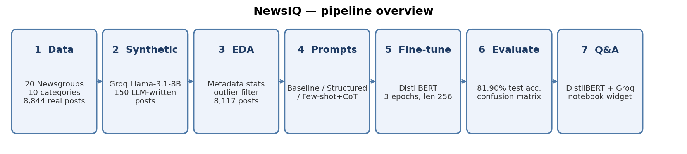
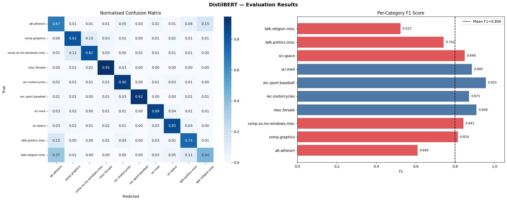
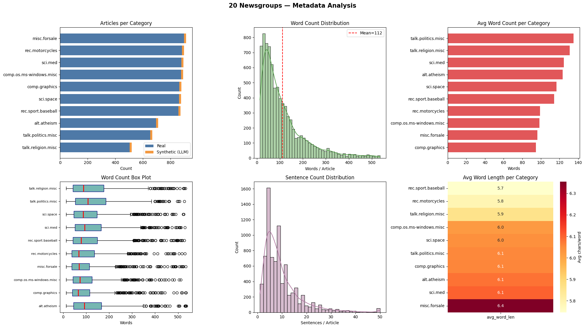

# 📰 NewsIQ — LLM-Augmented News Classification with DistilBERT

An end-to-end NLP project on the **20 Newsgroups** dataset: real Usenet posts are augmented with **LLM-generated synthetic articles (Groq / Llama-3.1-8B)**, analysed with metadata EDA, used to fine-tune **DistilBERT**, and explored through a small **conversational Q&A interface** at the end of the notebook.



## Highlights

- **Data:** 10 newsgroup categories, 8,844 real posts + 150 LLM-generated posts (15 per category).
- **EDA:** word / sentence counts, lexical density, vocabulary size, class balance; 5th–95th percentile word-count outlier filtering (8,994 → 8,117 posts).
- **Prompt experiments:** three zero-shot classification prompt styles (Baseline, Structured, Few-Shot + CoT) evaluated on Groq.
- **Fine-tuning:** `distilbert-base-uncased`, 3 epochs, lr 2e-5, batch size 16, max length 256, stratified 80/20 split.
- **Result:** **81.90 % test accuracy** (macro F1 0.80) on 1,624 held-out posts.
- **Q&A widget:** ask questions about the dataset, or paste an article to have DistilBERT classify it and Groq explain the prediction.

## Results

| Category | Precision | Recall | F1 |
|---|---|---|---|
| alt.atheism | 0.56 | 0.67 | 0.61 |
| comp.graphics | 0.81 | 0.82 | 0.81 |
| comp.os.ms-windows.misc | 0.86 | 0.82 | 0.84 |
| misc.forsale | 0.87 | 0.95 | 0.91 |
| rec.motorcycles | 0.84 | 0.90 | 0.87 |
| rec.sport.baseball | 0.99 | 0.92 | 0.96 |
| sci.med | 0.89 | 0.88 | 0.88 |
| sci.space | 0.85 | 0.85 | 0.85 |
| talk.politics.misc | 0.74 | 0.74 | 0.74 |
| talk.religion.misc | 0.64 | 0.44 | 0.52 |
| **Overall accuracy** | | | **0.82** |

Sports, sci and for-sale posts are classified well; the weakest classes are `talk.religion.misc` and `alt.atheism`, which overlap heavily in vocabulary.



### Dataset metadata



## Notes & limitations

- **The Q&A interface is conversational QA, not RAG.** Dataset statistics and a few sample articles are injected into the LLM system prompt; there is no embedding model, vector store or semantic retrieval step. Classification queries are routed to the fine-tuned DistilBERT and the LLM explains the result.
- Synthetic data is only ~1.8 % of the final dataset (150 posts), so the accuracy mainly reflects the real 20 Newsgroups data. A real-only vs. real+synthetic ablation would be the natural next experiment.
- Reported accuracy is from a single train/test split and a single run.
- The prompt-comparison cells (Step 5 / Step 7c) were fixed for a placeholder bug that caused the Baseline prompt to score 0 %; their saved outputs were cleared, so **re-run them** to regenerate the comparison chart.
- Interactive widgets (the Q&A box) need a live Jupyter/Colab kernel and do not run inside GitHub's notebook preview.

## Getting started

```bash
git clone <your-repo-url>
cd NewsIQ
pip install -r requirements.txt
export GROQ_API_KEY="your-key-here"     # free key: https://console.groq.com
jupyter notebook NewsIQ.ipynb
```

On Google Colab, add the key as a **Secret** named `GROQ_API_KEY` instead. Never paste API keys into the notebook.

## Repository structure

```text
NewsIQ/
├── README.md
├── NewsIQ.ipynb
├── requirements.txt
├── .gitignore
└── assets/
    ├── project-overview.png
    ├── confusion-matrix.png
    └── metadata-analysis.png
```

## Tech stack

Python · PyTorch · Hugging Face Transformers / Datasets · scikit-learn · NLTK · Groq API (Llama-3.1-8B-Instant) · ipywidgets
